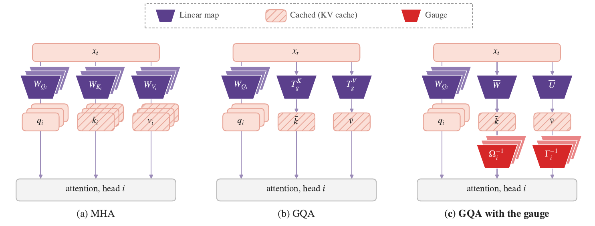

# GaugeMLA: code, data and Colab notebooks

The attention mechanism has free parameters that do not change its output: a trained model's key and value weights
are one of many bases, related by a gauge symmetry, that give the same query–key and output–value circuits.
Converting a model to a smaller KV cache is an initialisation followed by uptraining, and these free parameters can
be used to limit the damage the initialisation does to attention. Earlier work on tying key and value heads uses
only orthogonal matrices as the gauge, the rotations of the query–key inner product (Jin et al., 2024; TransMLA).
GaugeMLA is the initialisation that naturally arises from acknowledging the whole symmetry, and it fully leverages
the gauge freedom for a superior initialisation. It converts a model's attention to Multi-head Latent Attention
(MLA) by minimising the KL divergence to the original model over every change of basis the gauge allows; rotary
positional embeddings restrict the gauge, and decoupling the rotary key, as MLA does, restores it.

## The gauge symmetry of attention

Write $x \in \mathbb{R}^{1 \times d_m}$ for a token and $X \in \mathbb{R}^{T \times d_m}$ for a sequence of $T$ tokens.
Head $i$ forms queries, keys and values $Q_i = X W_{Q_i}^\top$, $K_i = X W_{K_i}^\top$ and $V_i = X W_{V_i}^\top$, and
its output projection $W_{O_i}$ writes the result back into the residual stream. With the query–key (QK) and
output–value (OV) circuits

$$M_i = W_{Q_i}^\top W_{K_i}, \qquad N_i = W_{O_i} W_{V_i},$$

attention reads

$$\mathrm{Attn}(X) = \sum_{i=1}^{H} \mathrm{softmax}\left(\frac{X M_i X^\top}{\sqrt{d_k}}\right) X N_i^\top .$$

The weights enter only through the two circuits. For any invertible $\Omega_i \in \mathrm{GL}(d_k)$ and
$\Gamma_i \in \mathrm{GL}(d_v)$, the change of basis

$$W_{K_i} \mapsto \Omega_i W_{K_i}, \quad W_{Q_i} \mapsto \Omega_i^{-\top} W_{Q_i}, \qquad W_{V_i} \mapsto \Gamma_i W_{V_i}, \quad W_{O_i} \mapsto W_{O_i} \Gamma_i^{-1}$$

leaves both circuits, and so the output of attention, unchanged:

$$M_i \mapsto \left(\Omega_i^{-\top} W_{Q_i}\right)^\top \Omega_i W_{K_i} = W_{Q_i}^\top \Omega_i^{-1} \Omega_i W_{K_i} = M_i, \qquad N_i \mapsto W_{O_i} \Gamma_i^{-1} \Gamma_i W_{V_i} = N_i .$$

The gauges $\Omega_i$ and $\Gamma_i$ are free parameters: the original model does not depend on them, but once heads
share a compressed cache they decide how much each head is damaged (Figure 1). Orthogonal gauges, for which
$\Omega_i^{-\top} = \Omega_i$, are the rotations of the query–key inner product that earlier work uses; GaugeMLA uses
the whole of $\mathrm{GL}$. With rotary positional embeddings the logit between positions $m$ and $n$ is
$x_m W_{Q_i}^\top R_\delta W_{K_i} x_n^\top$ with $\delta = n - m$, so the key gauge must commute with every rotation,
$\Omega_i R_\delta = R_\delta \Omega_i$; decoupling the rotary key, as MLA does, leaves the rest of the key's gauge free.

Figure 1: MHA, GQA, and GQA with the gauge it leaves hidden; a stack means one per head. (a) Every head has its own
key and value maps and caches its own key and value. (b) GQA caches one mean-pooled key and value per group. (c) The
cache is GQA's, and each head reads it through its own gauges Ωi-1 and
Γi-1, which are never cached. In the original model a gauge changes nothing, since the head's
query and output maps absorb it; once heads share a cache, the gauges decide how much each head is damaged. GQA
fixes them at I and earlier head-tying methods use only orthogonal ones. The figure shows GQA with its gauge, not
GaugeMLA: it is the basic motivation of GaugeMLA, which fully leverages this gauge freedom, choosing every change of
basis to limit the damage to attention, for a superior initialisation.

## Results

GaugeMLA almost always initialises the compressed model so that its attention mechanism is better preserved, an
advantage which persists through 50M tokens of knowledge distillation. Only attention is converted, so the KL
divergence to the original model measures what the conversion loses; the KL divergence to the teacher is what
distillation minimises.

<!-- generated by make_readme_tables.py from the paper's tables; every number re-derived from results/ -->

GaugeMLA has the lowest KL of the MLA conversions at t = 0 in 20 of the 21 model–budget pairs, to the original model and to the teacher alike, and in 21 of 21 (to the original) and 21 of 21 (to the teacher) after 50M tokens.

**Table 8.** KL to the teacher at conversion of GaugeMLA, its three ablations and the baselines, lower is better.

| model | KV cache | GaugeMLA | F_i = I | Σ = I | Both = I | TransMLA | MHA2MLA | CARE |
|---|---|---|---|---|---|---|---|---|
| Pythia-410m | 6.25% | **3.423** ± 0.03 | 4.357 | 3.534 ± 0.02 | 4.784 | 4.561 | 4.768 | 4.567 |
|  | 12.5% | **1.357** ± 0.01 | 2.079 | 1.876 ± 0.02 | 4.347 | 2.990 | 3.930 | 2.919 |
|  | 25% | **0.623** ± 0.00 | 0.900 | 1.012 ± 0.02 | 3.716 | 1.134 | 2.862 | 1.090 |
| StableLM-2-1.6B | 6.25% | **2.126** ± 0.01 | 2.417 | 3.432 ± 0.03 | 8.474 | 2.976 | 7.901 | 2.913 |
|  | 12.5% | **0.917** ± 0.01 | 1.111 | 1.763 ± 0.03 | 4.442 | 0.975 | 4.534 | 0.976 |
|  | 25% | 0.536 ± 0.00 | 0.612 | 0.810 ± 0.00 | 2.219 | **0.497** | 3.857 | **0.497** |
| Qwen1.5-0.5B | 6.25% | **3.999** ± 0.05 | 4.328 | 5.475 ± 0.15 | 6.965 | 5.222 | 6.512 | 5.247 |
|  | 12.5% | **1.682** ± 0.02 | 2.971 | 2.598 ± 0.09 | 5.315 | 4.766 | 4.888 | 4.686 |
|  | 25% | **0.882** ± 0.00 | 1.671 | 1.435 ± 0.03 | 3.589 | 2.442 | 3.977 | 2.424 |
| OLMo-1B | 6.25% | **3.133** ± 0.05 | 3.561 | 6.294 ± 0.13 | 7.519 | 5.011 | 7.210 | 5.043 |
|  | 12.5% | **2.429** ± 0.08 | 2.802 | 5.341 ± 0.09 | 6.390 | 4.173 | 7.762 | 4.058 |
|  | 25% | **2.282** ± 0.08 | 2.333 | 3.898 ± 0.14 | 5.339 | 3.329 | 4.762 | 3.314 |
| SmolLM-360M | 6.25% | **4.314** ± 0.02 | 4.392 | 7.066 ± 0.09 | 9.047 | 4.319 | 7.819 | – |
|  | 12.5% | **3.261** ± 0.02 | 3.582 | 7.355 ± 0.27 | 13.193 | 3.954 | 10.701 | – |
|  | 25% | **2.479** ± 0.03 | 3.032 | 4.639 ± 0.06 | 10.011 | 3.605 | 10.772 | – |
| TinyLlama-1.1B | 6.25% | **4.223** ± 0.02 | 4.760 | 5.503 ± 0.03 | 7.023 | 4.898 | 9.657 | – |
|  | 12.5% | **3.701** ± 0.02 | 4.457 | 6.869 ± 0.23 | 6.533 | 4.299 | 9.897 | – |
|  | 25% | **3.320** ± 0.02 | 4.698 | 6.515 ± 0.25 | 5.646 | 4.172 | 8.887 | – |
| Llama-3.2-1B | 6.25% | 5.646 ± 0.05 | 5.658 | **5.107** ± 0.03 | 6.561 | 5.840 | 7.533 | – |
|  | 12.5% | 4.879 ± 0.06 | 5.336 | **4.643** ± 0.03 | 5.621 | 5.279 | 6.560 | – |
|  | 25% | **3.857** ± 0.09 | 5.021 | 4.134 ± 0.09 | 5.404 | 5.023 | 5.328 | – |

**Table 9.** KL to the original model at conversion of GaugeMLA, its three ablations and the baselines.

| model | KV cache | GaugeMLA | F_i = I | Σ = I | Both = I | TransMLA | MHA2MLA | CARE |
|---|---|---|---|---|---|---|---|---|
| Pythia-410m | 6.25% | **3.121** ± 0.03 | 4.055 | 3.234 ± 0.02 | 4.480 | 4.253 | 4.465 | 4.259 |
|  | 12.5% | **1.049** ± 0.01 | 1.775 | 1.572 ± 0.02 | 4.042 | 2.684 | 3.626 | 2.613 |
|  | 25% | **0.305** ± 0.00 | 0.587 | 0.701 ± 0.02 | 3.410 | 0.823 | 2.556 | 0.778 |
| StableLM-2-1.6B | 6.25% | **1.824** ± 0.01 | 2.118 | 3.134 ± 0.03 | 8.182 | 2.680 | 7.601 | 2.616 |
|  | 12.5% | **0.603** ± 0.01 | 0.799 | 1.459 ± 0.03 | 4.144 | 0.660 | 4.237 | 0.662 |
|  | 25% | 0.211 ± 0.00 | 0.289 | 0.492 ± 0.00 | 1.915 | **0.167** | 3.556 | 0.168 |
| Qwen1.5-0.5B | 6.25% | **3.581** ± 0.05 | 3.913 | 5.058 ± 0.15 | 6.547 | 4.812 | 6.094 | 4.836 |
|  | 12.5% | **1.248** ± 0.02 | 2.549 | 2.174 ± 0.09 | 4.900 | 4.354 | 4.468 | 4.273 |
|  | 25% | **0.425** ± 0.00 | 1.236 | 0.995 ± 0.03 | 3.177 | 2.012 | 3.556 | 1.994 |
| OLMo-1B | 6.25% | **2.904** ± 0.05 | 3.337 | 6.074 ± 0.13 | 7.297 | 4.785 | 6.985 | 4.817 |
|  | 12.5% | **2.196** ± 0.08 | 2.569 | 5.116 ± 0.09 | 6.164 | 3.946 | 7.541 | 3.831 |
|  | 25% | **2.044** ± 0.08 | 2.096 | 3.668 ± 0.14 | 5.113 | 3.098 | 4.536 | 3.083 |
| SmolLM-360M | 6.25% | **3.922** ± 0.02 | 4.000 | 6.670 ± 0.09 | 8.643 | 3.928 | 7.438 | – |
|  | 12.5% | **2.868** ± 0.02 | 3.186 | 6.962 ± 0.27 | 12.785 | 3.564 | 10.301 | – |
|  | 25% | **2.083** ± 0.03 | 2.638 | 4.244 ± 0.06 | 9.624 | 3.211 | 10.375 | – |
| TinyLlama-1.1B | 6.25% | **3.988** ± 0.02 | 4.523 | 5.264 ± 0.03 | 6.776 | 4.664 | 9.421 | – |
|  | 12.5% | **3.465** ± 0.02 | 4.222 | 6.632 ± 0.24 | 6.294 | 4.061 | 9.665 | – |
|  | 25% | **3.084** ± 0.02 | 4.463 | 6.277 ± 0.25 | 5.407 | 3.935 | 8.646 | – |
| Llama-3.2-1B | 6.25% | 5.294 ± 0.05 | 5.305 | **4.755** ± 0.03 | 6.204 | 5.487 | 7.175 | – |
|  | 12.5% | 4.528 ± 0.06 | 4.986 | **4.293** ± 0.03 | 5.267 | 4.925 | 6.207 | – |
|  | 25% | **3.506** ± 0.09 | 4.671 | 3.781 ± 0.09 | 5.054 | 4.673 | 4.972 | – |

For GaugeMLA and Σ = I each entry is the mean ± s.d. over five draws. Bold is the lowest in each row. CARE is not performed for the grouped-query models (–).

**KL to the teacher and to the original model, at t = 0 and after 50M tokens of knowledge distillation.**

| model | method | KL to the | 6.25%, t = 0 | 6.25%, 50M | 12.5%, t = 0 | 12.5%, 50M | 25%, t = 0 | 25%, 50M |
|---|---|---|---|---|---|---|---|---|
| Pythia-410m | GaugeMLA | teacher | **3.423** ± 0.03 | **0.669** | **1.357** ± 0.01 | **0.464** | **0.623** ± 0.00 | **0.379** |
|  | GaugeMLA | original | **3.121** ± 0.03 | **0.375** | **1.049** ± 0.01 | **0.170** | **0.305** ± 0.00 | **0.087** |
|  | TransMLA | teacher | 4.561 | 0.681 | 2.990 | 0.481 | 1.134 | 0.395 |
|  | TransMLA | original | 4.253 | 0.387 | 2.684 | 0.185 | 0.823 | 0.101 |
|  | MHA2MLA | teacher | 4.768 | 0.774 | 3.930 | 0.541 | 2.862 | 0.431 |
|  | MHA2MLA | original | 4.465 | 0.481 | 3.626 | 0.247 | 2.556 | 0.140 |
|  | CARE | teacher | 4.567 | 0.681 | 2.919 | 0.482 | 1.090 | 0.412 |
|  | CARE | original | 4.259 | 0.387 | 2.613 | 0.185 | 0.778 | 0.118 |
| StableLM-2-1.6B | GaugeMLA | teacher | **2.126** ± 0.01 | **0.537** | **0.917** ± 0.01 | **0.434** | 0.536 ± 0.00 | **0.379** |
|  | GaugeMLA | original | **1.824** ± 0.01 | **0.245** | **0.603** ± 0.01 | **0.141** | 0.211 ± 0.00 | **0.083** |
|  | TransMLA | teacher | 2.976 | 0.541 | 0.975 | 0.441 | **0.497** | 0.383 |
|  | TransMLA | original | 2.680 | 0.250 | 0.660 | 0.146 | **0.167** | 0.088 |
|  | MHA2MLA | teacher | 7.901 | 0.698 | 4.534 | 0.561 | 3.857 | 0.480 |
|  | MHA2MLA | original | 7.601 | 0.408 | 4.237 | 0.270 | 3.556 | 0.185 |
|  | CARE | teacher | 2.913 | 0.542 | 0.976 | 0.442 | **0.497** | 0.384 |
|  | CARE | original | 2.616 | 0.251 | 0.662 | 0.147 | 0.168 | 0.088 |
| Qwen1.5-0.5B | GaugeMLA | teacher | **3.999** ± 0.05 | **0.755** | **1.682** ± 0.02 | **0.545** | **0.882** ± 0.00 | **0.469** |
|  | GaugeMLA | original | **3.581** ± 0.05 | **0.408** | **1.248** ± 0.02 | **0.203** | **0.425** ± 0.00 | **0.129** |
|  | TransMLA | teacher | 5.222 | 0.765 | 4.766 | 0.565 | 2.442 | 0.482 |
|  | TransMLA | original | 4.812 | 0.417 | 4.354 | 0.220 | 2.012 | 0.141 |
|  | MHA2MLA | teacher | 6.512 | 1.097 | 4.888 | 0.829 | 3.977 | 0.688 |
|  | MHA2MLA | original | 6.094 | 0.741 | 4.468 | 0.480 | 3.556 | 0.341 |
|  | CARE | teacher | 5.247 | 0.766 | 4.686 | 0.566 | 2.424 | 0.482 |
|  | CARE | original | 4.836 | 0.418 | 4.273 | 0.221 | 1.994 | 0.141 |
| OLMo-1B | GaugeMLA | teacher | **3.133** ± 0.05 | **0.469** | **2.429** ± 0.08 | **0.397** | **2.282** ± 0.08 | **0.358** |
|  | GaugeMLA | original | **2.904** ± 0.05 | **0.289** | **2.196** ± 0.08 | **0.215** | **2.044** ± 0.08 | **0.175** |
|  | TransMLA | teacher | 5.011 | 0.484 | 4.173 | 0.408 | 3.329 | 0.380 |
|  | TransMLA | original | 4.785 | 0.301 | 3.946 | 0.224 | 3.098 | 0.194 |
|  | MHA2MLA | teacher | 7.210 | 0.581 | 7.762 | 0.487 | 4.762 | 0.439 |
|  | MHA2MLA | original | 6.985 | 0.394 | 7.541 | 0.301 | 4.536 | 0.252 |
|  | CARE | teacher | 5.043 | 0.486 | 4.058 | 0.409 | 3.314 | 0.387 |
|  | CARE | original | 4.817 | 0.303 | 3.831 | 0.224 | 3.083 | 0.201 |
| SmolLM-360M | GaugeMLA | teacher | **4.314** ± 0.02 | **1.328** | **3.261** ± 0.02 | **0.798** | **2.479** ± 0.03 | **0.580** |
|  | GaugeMLA | original | **3.922** ± 0.02 | **0.966** | **2.868** ± 0.02 | **0.433** | **2.083** ± 0.03 | **0.210** |
|  | TransMLA | teacher | 4.319 | 1.696 | 3.954 | 1.034 | 3.605 | 0.744 |
|  | TransMLA | original | 3.928 | 1.338 | 3.564 | 0.671 | 3.211 | 0.379 |
|  | MHA2MLA | teacher | 7.819 | 2.312 | 10.701 | 1.763 | 10.772 | 1.262 |
|  | MHA2MLA | original | 7.438 | 1.949 | 10.301 | 1.395 | 10.375 | 0.895 |
| TinyLlama-1.1B | GaugeMLA | teacher | **4.223** ± 0.02 | **0.860** | **3.701** ± 0.02 | **0.528** | **3.320** ± 0.02 | **0.379** |
|  | GaugeMLA | original | **3.988** ± 0.02 | **0.674** | **3.465** ± 0.02 | **0.345** | **3.084** ± 0.02 | **0.199** |
|  | TransMLA | teacher | 4.898 | 1.022 | 4.299 | 0.620 | 4.172 | 0.452 |
|  | TransMLA | original | 4.664 | 0.834 | 4.061 | 0.436 | 3.935 | 0.269 |
|  | MHA2MLA | teacher | 9.657 | 1.634 | 9.897 | 1.186 | 8.887 | 0.838 |
|  | MHA2MLA | original | 9.421 | 1.441 | 9.665 | 0.996 | 8.646 | 0.648 |
| Llama-3.2-1B | GaugeMLA | teacher | **5.646** ± 0.05 | **0.802** | **4.879** ± 0.06 | **0.601** | **3.857** ± 0.09 | **0.491** |
|  | GaugeMLA | original | **5.294** ± 0.05 | **0.493** | **4.528** ± 0.06 | **0.295** | **3.506** ± 0.09 | **0.190** |
|  | TransMLA | teacher | 5.840 | 1.010 | 5.279 | 0.773 | 5.023 | 0.640 |
|  | TransMLA | original | 5.487 | 0.694 | 4.925 | 0.461 | 4.673 | 0.330 |
|  | MHA2MLA | teacher | 7.533 | 1.381 | 6.560 | 1.086 | 5.328 | 0.864 |
|  | MHA2MLA | original | 7.175 | 1.061 | 6.207 | 0.767 | 4.972 | 0.551 |

GaugeMLA's t = 0 is the mean ± s.d. over five draws. Bold is the lowest of the methods for that model, budget, time and KL.

## About this repository

Code and logged results for GaugeMLA experiments. Each model's multi-head/grouped-query attention is converted to MLA
by GaugeMLA and by the methods it is compared with (TransMLA and MHA2MLA on all seven models, CARE on the four
multi-head ones), then trained by knowledge distillation toward a larger teacher of its family, with the gradient
norm clipped at 1.0 every step. GaugeMLA's initialisation fits the true Fisher with each fit document's top 1% of
tokens (by gradient) left out.

## Requirements

- **A Google Colab Pro+ account.**
- **A Hugging Face token**, added as the Colab secret `HF_TOKEN` with notebook access.
- **Initialisation: a High-RAM CPU runtime** (Runtime → Change runtime type → CPU, High-RAM). It uses no GPU.
- **Training: an A100 GPU runtime with High-RAM.**
- **Google Drive space.** A Pythia-410m checkpoint is about 1.6 GB in fp32. The 50M grid's 12 initial checkpoints
  need about 20 GB, the 5M grid's about 43 GB, and each finished 50M branch saves one more model.

## Run it on Colab (Pythia-410m)

We provide notebooks on Colab for easy access to GPU resources. They have been tested, so they run without change.
Upload a notebook from `colab/` to Colab (File → Upload notebook), set its runtime, and run all cells. Run the
initialisation first.

| notebook | runtime | what it does |
|---|---|---|
| `colab/pythia410m_init.ipynb` | CPU, High-RAM | the t = 0 checkpoints of the 50M grid in one cell, then of the 5M grid in the next |
| `colab/pythia410m_train_50M.ipynb` | A100, High-RAM | 50M-token training of one branch (or all 12); saves each final model |
| `colab/pythia410m_train_5M.ipynb` | A100, High-RAM | 5M-token training of one branch (or all 24, the MHA control included) |

Each notebook mounts Google Drive, clones only the parts of the repository it uses, and starts that experiment's
script. Everything is written under `MyDrive/gaugemla/`:
`grad_clip/p410m_gc/` for the 50M grid and `grad_clip_5m/p410m_gc5m/` for the 5M grid, each with `init/`
(checkpoints), the fits (`fisher/`, `sigma/`, ...) and `runs/<stamp>/` (rows, and `models/` for 50M). The 5M grid
reads the 50M grid's fits and GaugeMLA checkpoints, as in the paper. Finished checkpoints and branches are skipped,
so a rerun continues where the last session stopped.

Set `TEST_TOKENS = 50000` for a quick test. The experiments in the paper trained on 50M tokens (5M for the 5M grid),
with more powerful computing resources.

## Data (`results/`)

Every logged result is here as JSON, including the ablation studies. Weights and fitted matrices (`.npz`) are not
included, but the fits and t = 0 checkpoints can be initialised quickly (`colab/pythia410m_init.ipynb`).

| folder | contents |
|---|---|
| `results/<model>_gc/` | **Main experiment**, 7 models: GaugeMLA, TransMLA and MHA2MLA on every model and CARE on the four multi-head ones, at 25 / 12.5 / 6.25% of the KV cache, 50M tokens. `runs/<stamp>/kd_*_<branch>_s42.jsonl` has one row per evaluation point (KL to the teacher with its standard error and per-document values, the task battery at selected points, gradient norms), beside the stamp's `_manifest.json`, reference and summary rows, and `models/*/` (each saved model's config and conversion record). `init/` holds each t = 0 checkpoint's record and `_cells.json`. |
| `results/full_eval/<model>_gc/` | The saved 50M models and their t = 0 starts, scored on the full task splits: `<branch>_t0.json`, `<branch>_50M.json`. |
| `results/p410m_gc5m/` | **Ablation over constructions** (Pythia-410m, 5M tokens): GQA pooling, GQA with the optimal gauge, Procrustes alignment, per-group and joint key/value subspaces, the decoupled KL-objective arm, GaugeMLA at w = 64 and at its KL width, and the MHA control. `comparison.md` sets these runs beside the earlier unclipped ones. |
| `results/init_ablation/` | **Ablation of GaugeMLA's objective** at t = 0, all 7 models: output metric F := I (`_fi`), input metric Sigma := I at five Fisher label seeds (`_si`), and both (`_ii`). `t0_ablation_table.md` is the summary table. |
| `results/tfx1_seeds/` | **Seed spread**: GaugeMLA's t = 0 at four more Fisher label seeds per model (five draws with the first). `t0_rows.tsv` lists every t = 0 KL; `README.txt` gives the layout. |

`names.tsv` files map shortened file names to the original run names.

| tag | model | teacher |
|---|---|---|
| `olmo1b_gc` | allenai/OLMo-1B-hf | allenai/OLMo-7B-hf (float32) |
| `p410m_gc` | EleutherAI/pythia-410m | EleutherAI/pythia-2.8b (float32) |
| `slm1p6b_gc` | stabilityai/stablelm-2-1_6b | stabilityai/stablelm-2-12b (float32) |
| `q0p5b_gc` | Qwen/Qwen1.5-0.5B | Qwen/Qwen1.5-4B (float32) |
| `l3_1b_gc` | meta-llama/Llama-3.2-1B | meta-llama/Llama-3.1-8B (float32) |
| `tl1b_gc` | TinyLlama/TinyLlama-1.1B-intermediate-step-1431k-3T | meta-llama/Llama-2-7b-hf (float32) |
| `sm360m_gc` | HuggingFaceTB/SmolLM-360M | HuggingFaceTB/SmolLM2-1.7B (float32) |

## Code

- `src/`: the method library (conversions, fits, architectures, and the registry `dt_grid_models.py`).
- `experiments/<experiment>/<tag>/<tag>_init.py`, `<tag>_run.py`: one pair per model and experiment, all in the
  same form. [`experiments/README.md`](experiments/README.md) says what each arm name means. `colab/launch.py` runs any of them: `launch.run("<tag>", "init")` on a High-RAM CPU runtime, then
  `launch.run("<tag>", "run", BRANCH=..., TEST_TOKENS=...)` on a GPU. The `_si` and `_seeds` kits also take
  `FISHER_LABEL_SEED` (20261014, 20262014, 20263014, 20264014 or 20265014). Models gated on the Hugging Face Hub
  need a Colab secret `HF_TOKEN` with access. The paper's runs used 48 GB and 96 GB GPUs; larger teachers need
  more GPU memory (StableLM-2-1.6B's 12B teacher alone takes 48 GB in fp32).
  - `grad_clip/` (7 models): the main experiment above, 50M tokens, gradient clipping 1.0, final models saved.
  - `grad_clip_5m/` (Pythia-410m): every construction, 5M tokens, the same training.
  - `init_ablation/` (21 kits) and `true_fisher_x1_seeds/` (7 kits): the t = 0 ablation and seed spread above.
  - `grad_clip/full_eval/`: the full-split task evaluation of the saved 50M models, in the cluster form it ran in.

For anonymity, comments and docstrings have been removed from the code, and names and absolute paths have been
redacted from strings in `results/`. All numbers are as logged. Hashes recorded in `results/` refer to the original
files.
