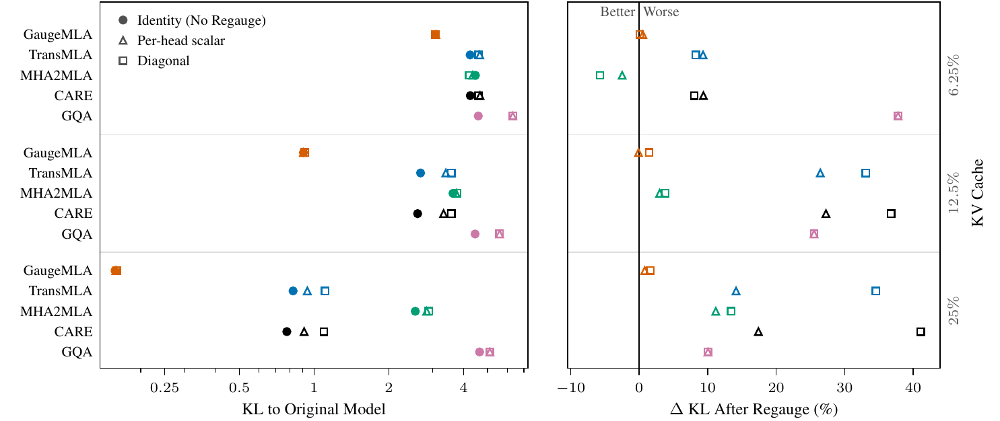
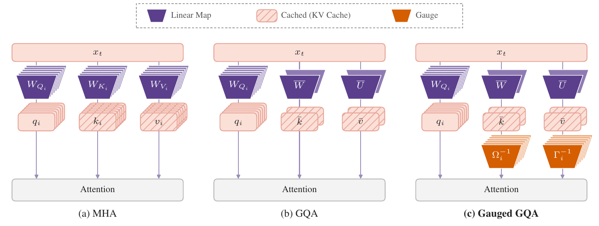

# GaugeMLA: code, data and Colab notebooks

Attention has an underexplored gauge symmetry: a change of basis inside each head alters a trained model's key and
value weights but leaves its query–key and output–value circuits and hence its output unchanged. Yet existing
initialisation methods for KV cache compression perform better or worse depending on the basis
([the regauge test](experiments/regauge_test/)), despite the model being intrinsically unchanged, and may therefore
need longer or shorter uptraining to recover the original model's ability. We introduce GaugeMLA, an initialisation
that uses this gauge freedom to minimise the change in a trained model's output when converting to Multi-head Latent
Attention (MLA). Our analysis reveals that the optimal shared map for tying or merging key and value heads is not the
mean pool but is set by the gauge-invariant query–key and output–value circuits. GaugeMLA leverages the KL
divergence to the original model as a consistent focus which motivates both how to normalise the keys against the
values and how to un-rope rotary key rows, for a strong, gauge-invariant initialisation. On seven models and three KV
cache budgets, GaugeMLA provides a better initialisation than other MLA conversion methods in almost all cases, an
advantage that persists through knowledge distillation to the final model.

Figure 1: Pythia-410m's KL to the uncompressed original model when regauged before initialisation, at 6.25%, 12.5%
and 25% of its KV cache ([the regauge test](experiments/regauge_test/)). Both regauges leave the original model
unchanged. Left, the KL, lower is better. Right, its change as a percentage of the unregauged KL. GaugeMLA's relative
change under a regauge is small compared to the other methods, which get better or worse.

## The gauge symmetry of attention

Write $x \in \mathbb{R}^{1 \times d_m}$ for a token and $X \in \mathbb{R}^{T \times d_m}$ for a sequence of $T$ tokens.
Head $i$ forms queries, keys and values $Q_i = X W_{Q_i}^\top$, $K_i = X W_{K_i}^\top$ and $V_i = X W_{V_i}^\top$, and
its output projection $W_{O_i}$ writes the result back into the residual stream. With the query–key (QK) and
output–value (OV) circuits

$$M_i = W_{Q_i}^\top W_{K_i}, \qquad N_i = W_{O_i} W_{V_i},$$

attention reads

$$\mathrm{Attn}(X) = \sum_{i=1}^{H} \mathrm{softmax}\left(\frac{X M_i X^\top}{\sqrt{d_k}}\right) X N_i^\top .$$

The weights enter only through the two circuits. For any invertible $\Omega_i \in \mathrm{GL}(d_k)$ and
$\Gamma_i \in \mathrm{GL}(d_v)$, the change of basis

$$W_{K_i} \mapsto \Omega_i W_{K_i}, \quad W_{Q_i} \mapsto \Omega_i^{-\top} W_{Q_i}, \qquad W_{V_i} \mapsto \Gamma_i W_{V_i}, \quad W_{O_i} \mapsto W_{O_i} \Gamma_i^{-1}$$

leaves both circuits, and so the output of attention, unchanged:

$$M_i \mapsto \left(\Omega_i^{-\top} W_{Q_i}\right)^\top \Omega_i W_{K_i} = W_{Q_i}^\top \Omega_i^{-1} \Omega_i W_{K_i} = M_i, \qquad N_i \mapsto W_{O_i} \Gamma_i^{-1} \Gamma_i W_{V_i} = N_i .$$

The gauges $\Omega_i$ and $\Gamma_i$ are free: the original model does not depend on them, but once heads share a
compressed cache they decide how much each head is damaged (Figure 2). Earlier work uses orthogonal gauges
($\Omega_i^{-\top} = \Omega_i$), the rotations of the query–key inner product; GaugeMLA uses the whole of
$\mathrm{GL}$. With rotary positional embeddings the key gauge must commute with every rotation,
$\Omega_i R_\delta = R_\delta \Omega_i$; decoupling the rotary key, as MLA does, leaves the rest of the key's gauge free.

[`experiments/regauge_test/`](experiments/regauge_test/) applies two such gauges to Pythia-410m before converting it
(Figure 1); its README defines the gauges and gives the paper's Tables 4 and 5.

Figure 2: A single attention layer for MHA, GQA, and Gauged GQA. (a) MHA: H query, key and value heads, each caching
its own key and value. (b) GQA: the H key and value heads are replaced by group maps $\bar{W}$ and $\bar{U}$.
(c) Gauged GQA: the cache is GQA's, and each head reads it through its own gauges Ωi-1 and
Γi-1, which are never cached and help recover the original model's QK and OV circuits.

Gauged GQA is the basic motivation of GaugeMLA, which fully leverages this gauge freedom, choosing every change of
basis to limit the damage to attention, for a superior initialisation.

## The KL objective

GaugeMLA minimises the KL divergence of the converted model from the original,

$$\mathrm{KL}\left(p_O \,\|\, p_S\right) = \mathbb{E}_{v \sim p_O}\left[\log p_O(v) - \log p_S(v)\right],$$

where $p_O$ is the original model's next-token distribution and $p_S$ the converted model's. With the rotary key
decoupled, keys and values both read a single content latent $\bar{C}$, and head $i$'s damage is

$$\Delta_i^{K} = W_{K_i}^{\mathrm{nr}} - \Omega_i^{-1} \bar{C}, \qquad \Delta_i^{V} = W_{V_i} - \Gamma_i^{-1} \bar{C},$$

where $W_{K_i}^{\mathrm{nr}}$ is the non-rotary part of the key map. Expanding to second order in $\Delta_i$,

$$\mathrm{KL}\left(p_O \,\|\, p_S\right) \approx \tfrac{1}{2} \sum_i \mathrm{tr}\left(\Delta_i^\top F_i \Delta_i \Sigma\right),$$

where the sum runs over keys and values ($\Delta_i$ is $\Delta_i^{K}$ or $\Delta_i^{V}$). The two factors say which
directions of the damage matter:

- $\Sigma = \mathbb{E}[x^\top x]$, the input metric (one per layer), is the second moment of the attention input after
  the layer norm. Damage along input directions the layer rarely sees costs little.
- $F_i = \mathbb{E}[g^\top g]$, the output metric (one per head, for keys and for values), is the second moment of the
  loss gradient $g$ at that head's key or value output, with the next token drawn from the model's own prediction:
  the Fisher information of the original model. Damage along directions the next-token distribution is insensitive
  to costs little.

Both are measured on 64 calibration passages of 512 tokens from The Pile, disjoint from the evaluation passages, on
which TransMLA, MHA2MLA and CARE also measure their statistics. For each passage and layer, $F_i$'s average leaves out
the 1% of tokens with the largest gradient, chiefly the first token, an attention sink with an extreme gradient.

## Results

GaugeMLA almost always preserves the attention mechanism better at initialisation, an advantage which persists
through 50M tokens of knowledge distillation. Only attention is converted, so the KL to the original model measures
what the conversion loses; the KL to the teacher is what distillation minimises.

<!-- generated by make_readme_tables.py from the paper's tables; every number re-derived from results/ -->

GaugeMLA has the lowest KL of the MLA conversions in 20 of the 21 model–budget pairs at t = 0, all but Llama-3.2-1B at 6.25%, where CARE and TransMLA are lower, and in 21 of the 21 after 50M tokens of knowledge distillation, to the original model and to the teacher alike. Even its un-roping ablation $A_p^{\mathrm{mean}}$, the earlier GaugeMLA without the KL stand-in, is below TransMLA, MHA2MLA and CARE at t = 0 in 18 of the 21, all but StableLM-2-1.6B at 25%, SmolLM-360M at 6.25% and Llama-3.2-1B at 6.25%.

Every method's KL at t = 0 and after 50M tokens, on all seven models and three budgets, is in
[`results/README.md`](results/README.md#kl-at-conversion-and-after-50m-tokens).

## Requirements

- A Google Colab Pro+ account, and a Hugging Face token added as the Colab secret `HF_TOKEN` with notebook access.
- A High-RAM CPU runtime for initialisation (it uses no GPU), and an A100 GPU runtime for training.
- Free Google Drive space: at least 15 GB for GaugeMLA alone, 90 GB for the full experiments and 95 GB for the
  regauge test. Use the same Google account in every notebook.

Run a quick test first (`TEST_TOKENS = 50000`), then `TEST_TOKENS = 2000000` to see that training lowers the KL. A
test saves its models under `runs/<stamp>-test<N>/models/`, which can be deleted afterwards.

## Run it on Colab (Pythia-410m)

| notebook | runtime | what it does |
|---|---|---|
| `colab/pythia410m_gaugemla.ipynb` | A100 | GaugeMLA (arm `mla_w64_ours_unrope_cost_kl`) alone: its t = 0 checkpoints at 25, 12.5 and 6.25%, then 50M-token training |
| `colab/pythia410m_init.ipynb` | CPU, High-RAM | every method's t = 0 checkpoints for the two training notebooks: run it first |
| `colab/pythia410m_train_50M.ipynb` | A100 | 50M-token training of GaugeMLA, TransMLA, MHA2MLA, CARE and the ablation $A_p^{\mathrm{mean}}$ |
| `colab/pythia410m_train_5M.ipynb` | A100 | 5M-token training of GaugeMLA and the other constructions, the MHA control included |
| `colab/pythia410m_regauge.ipynb` | CPU, High-RAM, then A100 | the regauge test, the paper's Figure 1 and Tables 4 and 5: see [`experiments/regauge_test/README.md`](experiments/regauge_test/README.md) |

## Data and code

The logged 50M training runs of every method on all seven models, and GaugeMLA's evaluation on the full task splits,
are in [`results/`](results/README.md) as JSON. The code is in [`src/`](src/README.md), the method library, and
[`experiments/`](experiments/README.md), each experiment's scripts.

For anonymity, the code's original comments and docstrings have been removed, and names and absolute paths have been
redacted from strings in `results/`. All numbers are as logged; hashes recorded in `results/` refer to the original
files.
