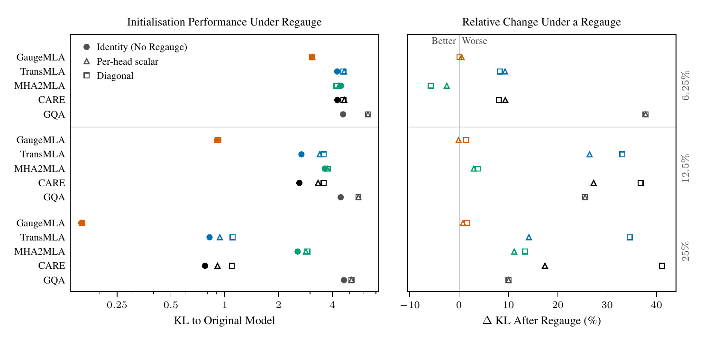
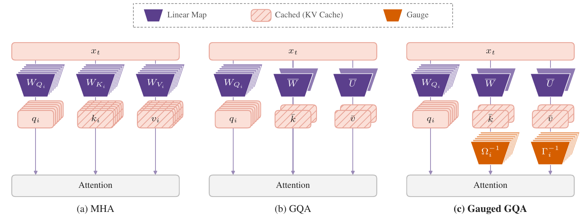

# GaugeMLA: code, data and Colab notebooks

Attention has an underexplored gauge symmetry: a change of basis inside each head alters a trained model's key and
value weights but leaves its query–key and output–value circuits, and hence its output, unchanged. A KV cache
compression method should therefore perform the same under any regauge, as the model has not fundamentally changed.
Existing initialisation methods do not. They perform better or worse depending on the regauge
([the regauge test](experiments/regauge_test/)), and may therefore need longer or shorter uptraining to recover the
original model's ability. Rather than fixing the gauge, GaugeMLA uses this freedom to minimise the change in the
compressed model's output. Tying heads in groups damages the circuits as much as a single shared content latent or
more, and rotary positional embeddings (RoPE) restrict the gauge, which the decoupled RoPE of Multi-head Latent
Attention (MLA) restores. From these findings GaugeMLA emerges. It converts a model's attention to MLA by minimising
the KL divergence to the original model over the gauge, an objective that motivates how to initialise MLA and how to
un-rope the rotary key rows. On seven models and three KV cache budgets, GaugeMLA provides a better initialisation
than other MLA conversion methods, and the advantage persists through knowledge distillation to the final model.

Figure 1: Pythia-410m regauged on its keys and values in two ways that leave its outputs unchanged
([the regauge test](experiments/regauge_test/) defines both), then converted at 6.25%, 12.5% and 25% of its KV cache.
Left, KL to the original model, lower is better. Right, the change as a percentage. GaugeMLA's relative change under
a regauge is small compared to the other methods, which get better or worse.

## The gauge symmetry of attention

Write $x \in \mathbb{R}^{1 \times d_m}$ for a token and $X \in \mathbb{R}^{T \times d_m}$ for a sequence of $T$ tokens.
Head $i$ forms queries, keys and values $Q_i = X W_{Q_i}^\top$, $K_i = X W_{K_i}^\top$ and $V_i = X W_{V_i}^\top$, and
its output projection $W_{O_i}$ writes the result back into the residual stream. With the query–key (QK) and
output–value (OV) circuits

$$M_i = W_{Q_i}^\top W_{K_i}, \qquad N_i = W_{O_i} W_{V_i},$$

attention reads

$$\mathrm{Attn}(X) = \sum_{i=1}^{H} \mathrm{softmax}\left(\frac{X M_i X^\top}{\sqrt{d_k}}\right) X N_i^\top .$$

The weights enter only through the two circuits. For any invertible $\Omega_i \in \mathrm{GL}(d_k)$ and
$\Gamma_i \in \mathrm{GL}(d_v)$, the change of basis

$$W_{K_i} \mapsto \Omega_i W_{K_i}, \quad W_{Q_i} \mapsto \Omega_i^{-\top} W_{Q_i}, \qquad W_{V_i} \mapsto \Gamma_i W_{V_i}, \quad W_{O_i} \mapsto W_{O_i} \Gamma_i^{-1}$$

leaves both circuits, and so the output of attention, unchanged:

$$M_i \mapsto \left(\Omega_i^{-\top} W_{Q_i}\right)^\top \Omega_i W_{K_i} = W_{Q_i}^\top \Omega_i^{-1} \Omega_i W_{K_i} = M_i, \qquad N_i \mapsto W_{O_i} \Gamma_i^{-1} \Gamma_i W_{V_i} = N_i .$$

The gauges $\Omega_i$ and $\Gamma_i$ are free parameters: the original model does not depend on them, but once heads
share a compressed cache they decide how much each head is damaged (Figure 2). Orthogonal gauges, for which
$\Omega_i^{-\top} = \Omega_i$, are the rotations of the query–key inner product that earlier work uses; GaugeMLA uses
the whole of $\mathrm{GL}$. With rotary positional embeddings the logit between positions $m$ and $n$ is
$x_m W_{Q_i}^\top R_\delta W_{K_i} x_n^\top$ with $\delta = n - m$, so the key gauge must commute with every rotation,
$\Omega_i R_\delta = R_\delta \Omega_i$; decoupling the rotary key, as MLA does, leaves the rest of the key's gauge free.

[`experiments/regauge_test/`](experiments/regauge_test/) applies two such gauges to Pythia-410m and converts the
regauged checkpoint with each of the four MLA methods and with GQA's mean pool (Figure 1). Its README defines the
gauges and gives the paper's Tables 3 and 4: the baselines' initialisations get better or worse with the gauge, and
GQA's mean pool gets worse, while GaugeMLA's barely moves. The GQA row comes from the kit `p410m_rgkv_gqa`.

Figure 2: A single attention layer for MHA, GQA, and Gauged GQA. (a) MHA: H query, key and value heads, each caching
its own key and value. (b) GQA: the H key and value heads are replaced by group maps $\bar{W}$ and $\bar{U}$.
(c) Gauged GQA: the cache is GQA's, and each head reads it through its own gauges Ωi-1 and
Γi-1, which are never cached and help recover the original model's QK and OV circuits.

The figure shows Gauged GQA, not GaugeMLA: it is the basic motivation of GaugeMLA, which fully leverages this gauge
freedom, choosing every change of basis to limit the damage to attention, for a superior initialisation.

## The KL objective

What initialisation is for is the converted model's output, so GaugeMLA minimises the KL divergence from the original
model,

$$\mathrm{KL}\left(p_O \,\|\, p_S\right) = \mathbb{E}_{v \sim p_O}\left[\log p_O(v) - \log p_S(v)\right],$$

where $p_O$ is the original model's next-token distribution and $p_S$ the converted model's. With the rotary key
decoupled, keys and values both read a single content latent $\bar{C}$, and head $i$'s damage is

$$\Delta_i^{K} = W_{K_i}^{\mathrm{nr}} - \Omega_i^{-1} \bar{C}, \qquad \Delta_i^{V} = W_{V_i} - \Gamma_i^{-1} \bar{C},$$

where $W_{K_i}^{\mathrm{nr}}$ is the non-rotary part of the key map. Expanding to second order in $\Delta_i$,

$$\mathrm{KL}\left(p_O \,\|\, p_S\right) \approx \tfrac{1}{2} \sum_i \mathrm{tr}\left(\Delta_i^\top F_i \Delta_i \Sigma\right),$$

where the sum runs over keys and values ($\Delta_i$ is $\Delta_i^{K}$ or $\Delta_i^{V}$). The two factors say which
directions of the damage matter:

- $\Sigma = \mathbb{E}[x^\top x]$, **the input metric** (one per layer), is the second moment of the attention input
  (after the layer norm), from one forward pass. Damage along input directions the layer rarely sees costs little;
  $\Sigma = I$ counts every input direction alike.
- $F_i = \mathbb{E}[g^\top g]$, **the output metric** (one per head, for keys and for values), is the second moment of
  the loss gradient $g$ at that head's key or value output, from one forward and one backward pass with the next
  token at each position drawn from the model's own prediction: the second-order term of the KL is the Fisher
  information of the original model. Damage along key or value directions the next-token distribution is
  insensitive to costs little; $F_i = I$ counts every output direction alike.

Both are measured on a calibration set of 64 passages of 512 tokens from The Pile, disjoint from the evaluation
passages; TransMLA, MHA2MLA and CARE measure their statistics on the same passages. For each passage and layer, the
1% of tokens with the largest gradient at the key and value projections are left out of $F_i$'s average: a few tokens
dominate it, chiefly each passage's first token, which becomes an attention sink with an extreme gradient. $\Sigma$
keeps every token.

GaugeMLA chooses the latent, the gauges and which rotary rows to un-rope by this objective. The rotary planes that do
not fit in the shared rotary width $d_h^{R}$ are un-roped: plane $p$ of head $i$ has its rotation, which depends on
the offset $\delta$, replaced by the fixed map that minimises an approximation of the KL objective,

$$R(\theta_p \delta) \;\longmapsto\; A^{\mathrm{KL}}_{ip} = \left(F^{aa}_{ip}\right)^{-1} F^{ab}_{ip},$$

where $F^{aa}_{ip}$ is the second moment of the gradient at the plane's keys with the rotation removed, and
$F^{ab}_{ip}$ its cross moment with the gradient itself. The approximation keeps the KL objective to second order and
drops the cross terms between keys at different positions. The un-roped rows are initialised as
$(W_{K_i}^{\mathrm{nr}})_p = A^{\mathrm{KL}}_{ip} (W_{K_i}^{\mathrm{rot}})_p$, with $(\cdot)_p$ plane $p$'s two rows.

The paper ablates two parts of this initialisation at conversion. The un-roping is replaced by $A_p^{\mathrm{mean}}$,
the mean rotation of plane $p$ over the causal offsets (the earlier GaugeMLA), and $\Sigma$ is set to $I$. The next
token drawn for $F_i$ is random, so the paper reports each t = 0 result of GaugeMLA and its ablations as the mean over
five draws.

## Results

GaugeMLA almost always initialises the compressed model so that its attention mechanism is better preserved, an
advantage which persists through 50M tokens of knowledge distillation. Only attention is converted, so the KL
divergence to the original model measures what the conversion loses; the KL divergence to the teacher is what
distillation minimises.

<!-- generated by make_readme_tables.py from the paper's tables; every number re-derived from results/ -->

GaugeMLA has the lowest KL of the MLA conversions in 21 of the 21 model–budget pairs at t = 0 and in 21 of the 21 after 50M tokens of knowledge distillation, to the original model and to the teacher alike. Even its un-roping ablation $A_p^{\mathrm{mean}}$, the earlier GaugeMLA without the KL stand-in, is below TransMLA, MHA2MLA and CARE at t = 0 in 20 of the 21, all but StableLM-2-1.6B at 25%.

Results of the 50M training runs are in
[`results/README.md`](results/README.md#kl-at-conversion-and-after-50m-tokens): every method's KL to the teacher and
to the original model, at t = 0 and after 50M tokens, on all seven models and three budgets, with every number
re-derived from the logged runs.

## About this repository

Code and logged results for GaugeMLA experiments. Each model's multi-head/grouped-query attention is converted to MLA
by GaugeMLA and by the methods it is compared with (TransMLA and MHA2MLA on all seven models, CARE on the four
multi-head ones), then trained by knowledge distillation toward a larger teacher of its family, with the gradient
norm clipped at 1.0 every step. GaugeMLA's initialisation fits the true Fisher with each fit document's top 1% of
tokens (by gradient) left out.

## Requirements

- **A Google Colab Pro+ account.**
- **A Hugging Face token**, added as the Colab secret `HF_TOKEN` with notebook access.
- **Initialisation: a High-RAM CPU runtime** (Runtime → Change runtime type → CPU, High-RAM). It uses no GPU.
- **Training: an A100 GPU runtime with High-RAM.**
- **Free Google Drive space for the checkpoints.** Every checkpoint is kept on Drive, about 1.6 GB each in fp32.
  - GaugeMLA alone (`pythia410m_gaugemla.ipynb`): **at least 15 GB free.** Its 3 t = 0 checkpoints and 3 trained
    models take about 10 GB.
  - The full experiments (`pythia410m_init.ipynb` and the two training notebooks): **at least 90 GB free.** The 36
    t = 0 checkpoints take about 60 GB (the 50M grid's 15, and 21 for the 5M grid, 3 of them copies of GaugeMLA's).
    The 15 trained 50M models take about 25 GB more. The 5M training saves no model.
  - The regauge test (`pythia410m_regauge.ipynb`): **at least 75 GB free.** Its 42 checkpoints take about 70 GB.
  - The regauge test's GQA kit (`pythia410m_regauge_gqa.ipynb`): **at least 20 GB free.** Its 9 checkpoints take
    about 15 GB.

  A quick test (`TEST_TOKENS = 50000`) saves its trained models too, under `runs/<stamp>-test50000/models/`, so delete
  that folder once you have checked the test. GaugeMLA's 15 GB has room for its test as well.

## Run it on Colab (Pythia-410m)

We provide notebooks on Colab for easy access to GPU resources. They have been tested, so they run without change.
Upload a notebook from `colab/` to Colab (File → Upload notebook), set its runtime, and run all cells. Run the
initialisation first.

**GaugeMLA, our method, is the arm `mla_w64_ours_unrope_cost_kl`** (kits `p410m_klgc` at 50M and `p410m_kl5m` at
5M). The arm `mla_w64_ours_unrope_cost` is its un-roping ablation $A_p^{\mathrm{mean}}$ (the earlier GaugeMLA), which
is built and trained with the baselines.

**To run GaugeMLA, use `colab/pythia410m_gaugemla.ipynb` only.** It builds GaugeMLA's three t = 0 checkpoints and
trains them, and nothing else. The init and two training notebooks are for the complete experiments, GaugeMLA beside
every method it is compared with, and `pythia410m_regauge.ipynb` runs the regauge test (`pythia410m_regauge_gqa.ipynb`
its GQA mean-pool row). The complete experiments
build every method's checkpoints (15 for the 50M grid and 21 more for the 5M grid, against GaugeMLA's 3), so they
take much longer to initialise.

| notebook | runtime | what it does |
|---|---|---|
| **GaugeMLA only** | | |
| `colab/pythia410m_gaugemla.ipynb` | A100, High-RAM | GaugeMLA's t = 0 checkpoints, then 50M-token training of its three branches (25, 12.5, 6.25%) |
| **The full experiments** | | |
| `colab/pythia410m_init.ipynb` | CPU, High-RAM | the t = 0 checkpoints of every method, in four cells: GaugeMLA, then TransMLA, MHA2MLA, CARE and $A_p^{\mathrm{mean}}$ (the 50M grid); GaugeMLA, then the other constructions (the 5M grid) |
| `colab/pythia410m_train_50M.ipynb` | A100, High-RAM | 50M-token training: GaugeMLA's 3 branches in one cell, the 12 of TransMLA, MHA2MLA, CARE and $A_p^{\mathrm{mean}}$ in the next; saves each final model |
| `colab/pythia410m_train_5M.ipynb` | A100, High-RAM | 5M-token training: GaugeMLA's 3 branches in one cell, the other constructions' 18 (the MHA control included) in the next |
| **The regauge test** | | |
| `colab/pythia410m_regauge.ipynb` | CPU, High-RAM, then A100 | the regauge test, the paper's Tables 3 and 4 (at least 75 GB free on Drive; not yet run on Colab): see [`experiments/regauge_test/README.md`](experiments/regauge_test/README.md) |
| `colab/pythia410m_regauge_gqa.ipynb` | CPU, High-RAM, then A100 | the regauge test's GQA row: the mean pool (`pool`) under the same two gauges, 9 cells at t = 0, the GQA row of Figure 1 and of Table 4 (at least 20 GB free on Drive; not yet run on Colab): see the same README |

Each notebook mounts Google Drive, clones only the parts of the repository it uses, and starts that experiment's
script. Everything is written under `MyDrive/gaugemla/`: `kl_standin_50m/p410m_klgc/` (GaugeMLA) and
`grad_clip/p410m_gc/` (the rest) for the 50M grid, and `kl_standin_5m/p410m_kl5m/` and `grad_clip_5m/p410m_gc5m/`
for the 5M grid. Each has `init/` (checkpoints), the fits (`fisher/`, `sigma/`, ...) and `runs/<stamp>/` (rows, and
`models/` for saved models). GaugeMLA's initialisation fits $F_i$ and $\Sigma$, and every other kit copies them, so
every method is built on the same fits, as in the paper. Training reads its t = 0 checkpoints from the same Drive
folders, so mount the same Google account in every notebook; the original model, the teacher and the text are
downloaded from the Hugging Face Hub in each session. Finished checkpoints and branches are skipped, so a rerun
continues where the last session stopped.

Set `TEST_TOKENS = 50000` for a quick test. The experiments in the paper trained on 50M tokens (5M for the 5M grid),
with more powerful computing resources.

## Data (`results/`)

The logged 50M training runs of every method, and GaugeMLA's evaluation on the full task splits, are here as JSON.
Weights and fitted matrices (`.npz`) are not included, but the fits and t = 0 checkpoints can be initialised quickly
(`colab/pythia410m_init.ipynb`). The paper's other experiments (the 5M comparison of constructions, the five draws of
$F_i$, the ablations and the regauge test) are included as code in `experiments/`, not as data. [`results/README.md`](results/README.md)
says which folder is GaugeMLA and how it differs from its ablation $A_p^{\mathrm{mean}}$.

| folder | contents |
|---|---|
| `results/kl_standin_50m/<model>/` | **GaugeMLA's 50M training runs**, 7 models, at 25 / 12.5 / 6.25% of the KV cache. `G<G>.jsonl` has one row per evaluation point (KL to the teacher and to the original model with their standard errors and per-document values, the task battery at selected points, gradient norms), beside the stamp's `manifest.json` and `reference.json`, `init/` (each t = 0 checkpoint's record) and `models/` (each saved model's config and conversion record). `NAMES.txt` maps these names to the original run names and gives each model's G per budget. |
| `results/<model>_gc/` | **The other methods' 50M training runs**, 7 models, the same recipe, evaluation documents and training stream: TransMLA and MHA2MLA on every model, CARE on the four multi-head ones, and the ablation $A_p^{\mathrm{mean}}$ (arm `mla_w*_ours_unrope_cost`). `runs/<stamp>/kd_*_<branch>_s42.jsonl` has the same rows, beside the stamp's `_manifest.json`, reference and summary rows, and `models/*/`. `init/` holds each t = 0 checkpoint's record and `_cells.json`. |
| `results/kl_standin_eval/<model>/` | **GaugeMLA on the full task splits**: its t = 0 initialisations (`G<G>_t0.json`) and saved 50M models (`G<G>_50M.json`), and the original model (`original.json`), each on the ten tasks. `NAMES.txt` maps the names to the original ones. |

The task battery logged in the run rows has 13 tasks. Ten are the paper's: LAMBADA, ARC-Easy, ARC-Challenge, PIQA,
HellaSwag, OpenBookQA, WinoGrande, BoolQ, SIQA and MMLU. Three are synthetic probes that are logged but not reported
in the paper:

- `induction`: a random 48-token sequence followed by its first 4 tokens again; the model must continue it with the
  next 8 tokens by copying.
- `kv_synth_N50`: fifty lines of the form "The code for ⟨word⟩ is ⟨number⟩.", then one of the words again; the model
  must recall its number.
- `arith_1d`: eight worked examples of one-digit addition, then a new pair of digits to add.

| tag | model | teacher |
|---|---|---|
| `olmo1b_gc` | allenai/OLMo-1B-hf | allenai/OLMo-7B-hf (float32) |
| `p410m_gc` | EleutherAI/pythia-410m | EleutherAI/pythia-2.8b (float32) |
| `slm1p6b_gc` | stabilityai/stablelm-2-1_6b | stabilityai/stablelm-2-12b (float32) |
| `q0p5b_gc` | Qwen/Qwen1.5-0.5B | Qwen/Qwen1.5-4B (float32) |
| `l3_1b_gc` | meta-llama/Llama-3.2-1B | meta-llama/Llama-3.1-8B (float32) |
| `tl1b_gc` | TinyLlama/TinyLlama-1.1B-intermediate-step-1431k-3T | meta-llama/Llama-2-7b-hf (float32) |
| `sm360m_gc` | HuggingFaceTB/SmolLM-360M | HuggingFaceTB/SmolLM2-1.7B (float32) |

## Our method in the code

GaugeMLA's own code, apart from the baselines':

- **Initialisation.** `src/dt_mla_ours.py` solves each layer's latent and read-out under the KL objective
  (`build_layer`, `build_weights`). `src/dt_mla_unrope.py` builds on it with the rotary rows that do not fit
  un-roped, and `src/dt_mla_unrope_width.py` gives their widths. `src/dt_mla_kl_standin.py` gives each un-roped
  plane its read-out $A^{\mathrm{KL}}_{ip}$ (`measure`, `standin`, `install`). `src/dt_mla_unrope_arms.py` (`build`)
  and `src/dt_mla_w64_ours_unrope_cost_kl.py` make it the arm `mla_w64_ours_unrope_cost_kl`.
- **The KL objective's two factors** are fitted in the initialisation script,
  `experiments/kl_standin_50m/p410m_klgc/p410m_klgc_init.py`: `fit_fisher` fits Fi, with the 1% token
  exclusion, and `fit_sigma` fits Σ. The KL stand-in is measured on the Fisher's own pass, in the same script.
  `compute_mla_width` gives the width table.
- **Training.** `experiments/kl_standin_50m/p410m_klgc/p410m_klgc_run.py` distils GaugeMLA (`train_branch`,
  `kd_loss`, gradient clipped at 1.0), and every other arm's run script trains the same way; `load_ckpt` loads a
  saved model.

[`src/README.md`](src/README.md) lists every module the initialisation imports.

## Code

- `src/`: the method library (conversions, fits, architectures, and the registry `dt_grid_models.py`).
  [`src/README.md`](src/README.md) lists the modules GaugeMLA's initialisation needs; training needs none of them.
- `experiments/<experiment>/<tag>/<tag>_init.py`, `<tag>_run.py`: one pair per model and experiment, all in the
  same form. [`experiments/README.md`](experiments/README.md) says what each arm name means. `colab/launch.py` runs any of them: `launch.run("<tag>", "init")` on a High-RAM CPU runtime, then
  `launch.run("<tag>", "run", BRANCH=..., TEST_TOKENS=...)` on a GPU. The `_seeds`, `_kls` and `_klsi` kits also take
  `FISHER_LABEL_SEED` (20262014, 20263014, 20264014 or 20265014, and 20261014 for `_klsi`). Models gated on the
  Hugging Face Hub need a Colab secret `HF_TOKEN` with access. The paper's runs used 48 GB and 96 GB GPUs; larger
  teachers need more GPU memory (StableLM-2-1.6B's 12B teacher alone takes 48 GB in fp32).
  - `kl_standin_50m/` (7 models): GaugeMLA, 50M tokens, gradient clipping 1.0, final models saved.
  - `grad_clip/` (7 models): TransMLA, MHA2MLA, CARE and $A_p^{\mathrm{mean}}$, the same training.
  - `kl_standin_5m/` and `grad_clip_5m/` (Pythia-410m): GaugeMLA and every other construction, 5M tokens, the same
    training.
  - `kl_standin_ablation/` (14 kits) and `true_fisher_x1_seeds/` (7 kits), t = 0 only: GaugeMLA at four more draws of
    $F_i$ (`_kls`), the ablation Σ = I at all five (`_klsi`), and $A_p^{\mathrm{mean}}$ at four more (`_seeds`).
  - `kl_standin_50m/kl_full_eval/`, `grad_clip/full_eval/` and `kl_standin_ablation/kl_abl_eval/`: the full-split task
    evaluations, as the batch scripts they ran as.
  - `regauge_test/p410m_rgkv/` (Pythia-410m), t = 0 only: the regauge test, run once per condition with `REGAUGE`.
    [`experiments/regauge_test/README.md`](experiments/regauge_test/README.md) defines the gauges, gives the paper's
    Tables 3 and 4, and says how to run it.
  - `regauge_test/p410m_rgkv_gqa/` (Pythia-410m), t = 0 only: GQA's mean pool under the same two gauges, three
    conditions by three budgets, with an identity check before the regauged conditions are measured. Its rows are
    the GQA row of Figure 1 and of the paper's Table 4.

For anonymity, comments and docstrings have been removed from the code, and names and absolute paths have been
redacted from strings in `results/`. All numbers are as logged. Hashes recorded in `results/` refer to the original
files.
